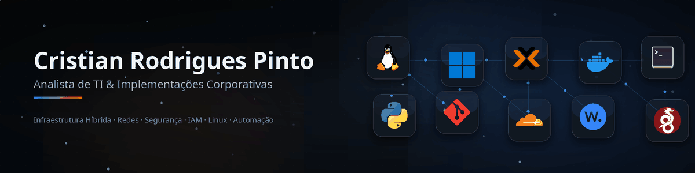

<!--
  README de perfil do GitHub — github.com/rodriguescris
  ---------------------------------------------------------------
  Publicação:
  1. O repositório "rodriguescris" já existe (branch padrão: main).
  2. Substitua o README.md da raiz por este arquivo.
  3. O GitHub renderiza o README automaticamente no perfil.

  Ícones: Dashboard Icons (homarr-labs/dashboard-icons), servidos via jsDelivr.
  ---------------------------------------------------------------
-->

  

  
  

---

## Perfil

Analista de TI com mais de cinco anos de experiência na operação e evolução de ambientes corporativos híbridos (Linux e Windows). Atuação orientada a **disponibilidade, segurança e eficiência de custo**, cobrindo administração de servidores e virtualização, redes e perímetro, gestão de identidade e acessos, e resposta a incidentes.

O diferencial da minha atuação é operar na fronteira entre a execução técnica e a decisão de negócio: traduzir risco técnico em prioridade de investimento e tratar infraestrutura como capacidade habilitadora, não como centro de custo.

## Stack

<table align="center">
  <tr>
    <td align="center" width="104"> <b>Linux</b></td>
    <td align="center" width="104"> <b>Windows Server</b> AD · GPO</td>
    <td align="center" width="104"> <b>Proxmox VE</b></td>
    <td align="center" width="104"> <b>Docker</b></td>
    <td align="center" width="104"> <b>Bash</b></td>
    <td align="center" width="104"> <b>Python</b></td>
  </tr>
  <tr>
    <td align="center" width="104"> <b>Google Workspace</b></td>
    <td align="center" width="104"> <b>Cloudflare</b> WAF · DNS</td>
    <td align="center" width="104"> <b>Wazuh</b></td>
    <td align="center" width="104"> <b>Wireshark</b></td>
    <td align="center" width="104"> <b>VPN</b></td>
    <td align="center" width="104"> <b>Git</b></td>
  </tr>
</table>

## Competências técnicas

| Domínio | Stack | Aplicação |
| :--- | :--- | :--- |
|  **Infraestrutura & Virtualização** | Linux, Windows Server, Proxmox VE, Docker | Administração de servidores, virtualização, padronização de estações e ciclo de vida de ativos |
|  **Redes & Perímetro** | Topologia, cabeamento estruturado, firewall, VPN, Cloudflare WAF | Configuração e manutenção de ativos de rede, segmentação e controle de acesso remoto |
|  **Segurança & Monitoramento** | Wazuh, Wireshark, análise de vulnerabilidades, hardening | Correção de vulnerabilidades em ativos e servidores, monitoramento, políticas de segurança e resposta a incidentes |
|  **Identidade & Acessos (IAM)** | Active Directory, GPO, Google Workspace | Provisionamento de contas, permissões de arquivos, políticas de grupo e gestão de licenças |
|  **Dados & Automação** | Python, SQL, Bash, Git | Scripts de operação, consultas e tratamento de dados, versionamento de configuração |
|  **Continuidade de Negócio** | Backup e recovery de bancos de dados e arquivos | Estratégia de backup, verificação de recuperação e continuidade operacional |
|  **Endpoint & Hardware** | Montagem, manutenção preventiva e corretiva, imagem corporativa | Padronização do parque, upgrades, diagnóstico de falhas e preparação para outsourcing |

## Experiência

**Simple Organic Beauty** — Analista de TI e Implementações · set/2022 – atual

- Administração de Active Directory, políticas de grupo (GPO) e permissões de arquivos em ambiente híbrido.
- Implantação e operação do helpdesk corporativo, com inventário de ativos e gestão de licenças.
- Gestão de backup de bancos de dados e arquivos, com foco em continuidade operacional.
- Hardening e correção de vulnerabilidades em servidores e ativos de rede.
- Configuração de firewall, VPN, regras de WAF (Cloudflare) e registro de domínios.
- Administração de Google Workspace: contas, e-mail e armazenamento em nuvem.
- Atualização de agentes de segurança e antivírus via GPO; monitoramento de CFTV/DVR e controle de acesso.

**INSite Business Solutions** — Técnico de Suporte · fev/2021 – ago/2022

- Montagem e manutenção preventiva e corretiva de computadores — origem da minha base em hardware.
- Redes cabeadas e Wi-Fi: instalação, cabeamento estruturado e diagnóstico de conectividade.
- Suporte técnico presencial e remoto a usuários finais.
- Gestão de inventário e preparação de equipamentos para contratos de outsourcing.

## Impacto entregue

- **Eficiência operacional:** serviços implantados com redução de custo e ganho de performance.
- **Continuidade:** estratégia de backup e recuperação que sustenta a operação sem interrupções.
- **Redução de risco:** menor superfície de ataque por meio de hardening e correção de vulnerabilidades.
- **Padronização:** parque de máquinas com imagem corporativa, entrada em domínio e atualização de agentes via GPO.

## Certificações

**Google Cybersecurity Professional Certificate** — Coursera · 6 de 8 cursos concluídos

| Curso | Credencial |
| :--- | :---: |
| Foundations of Cybersecurity | [Ver credencial](https://www.coursera.org/account/accomplishments/verify/VO4T4XWF164S) |
| Play It Safe: Manage Security Risks | [Ver credencial](https://www.coursera.org/account/accomplishments/verify/O4ACEGDDVE2D) |
| Connect and Protect: Networks and Network Security | [Ver credencial](https://www.coursera.org/account/accomplishments/verify/4WQU6XW6OBZW) |
| Tools of the Trade: Linux and SQL | [Ver credencial](https://www.coursera.org/account/accomplishments/verify/VMRM0SZG0YU9) |
| Assets, Threats, and Vulnerabilities | [Ver credencial](https://www.coursera.org/account/accomplishments/verify/PLDSRT1A69PJ) |
| Sound the Alarm: Detection and Response | [Ver credencial](https://www.coursera.org/account/accomplishments/verify/JCJP1NWNIMSZ) |

## Formação

**Tecnólogo em Desenvolvimento de Sistemas** — IFSC, Instituto Federal de Santa Catarina · 2018

## Projetos

Repositórios públicos em estruturação: automações de infraestrutura, scripts de hardening e laboratórios de redes e segurança. O escopo detalhado dos projetos descritos acima pode ser apresentado sob demanda.

## Contato

Aberto a conversas sobre infraestrutura, segurança e automação — e a oportunidades em times que tratam TI como produto.

  

---

## Contribuições

  <picture>
    <source media="(prefers-color-scheme: dark)" srcset="https://raw.githubusercontent.com/rodriguescris/rodriguescris/pacman-output/galaga-contribution-graph-dark.svg">
    
  </picture>

